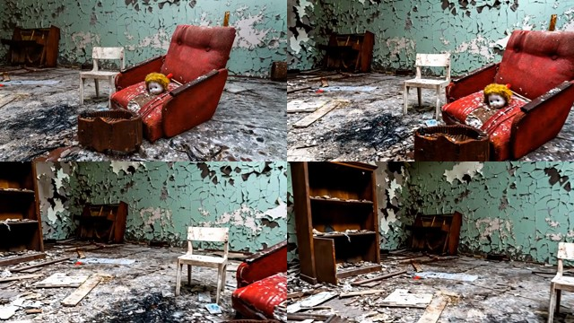
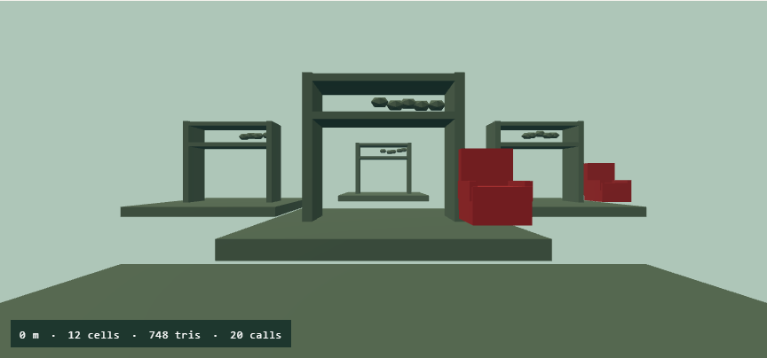
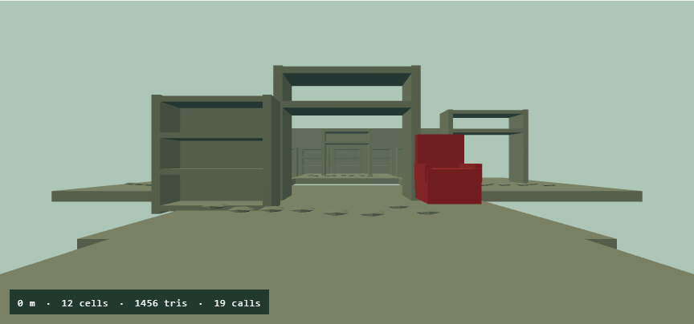
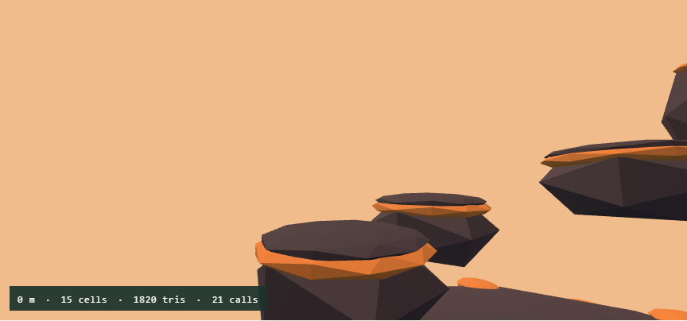
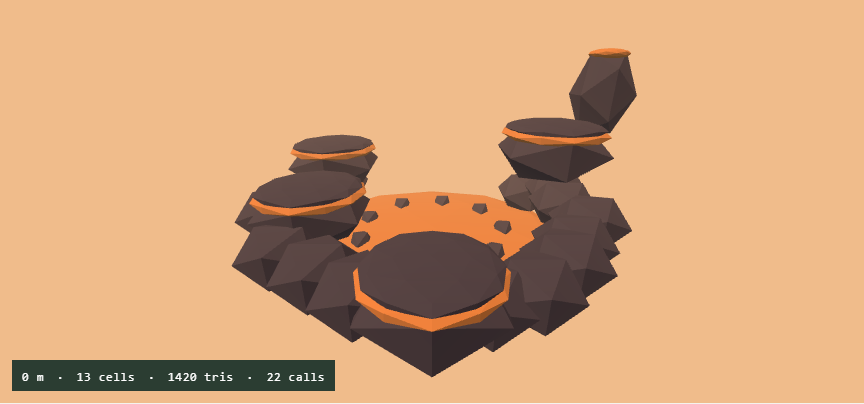
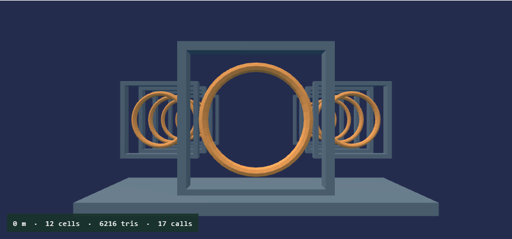
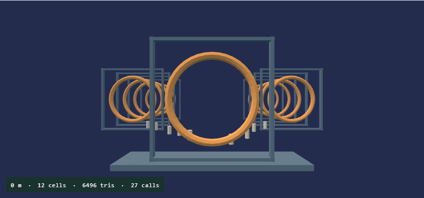

# From a camera pan to a playable room

The [measured frame comparison](../evidence/morph-case/visual-measurements.json) applies the same crop, resampling, luminance and edge thresholds to the 6 s reference frame and both spawn captures. Palette overlap fell from 0.301 to 0.252 after the edit. Visible shelf placement improved in the author's review while the distribution of colors moved farther from the reference. The report also records luminance by vertical third, horizontal and vertical edge fractions, and source frame changes across three time intervals. The views are unregistered. Reproduce with `python tools/visual-review.py` using Pillow and FFmpeg.

In the opening frame of the Canopy reference, a red armchair occupies the right foreground. At six seconds the chair has passed out of view and a dark shelving unit fills the left edge. Those two landmarks survived the move to WorldIR. A player entering the finished scene can see the chair on the right, the shelves on the left and a route between them. Open `?world=canopy` on a local build. [Distributed clip](../examples/canopy-source.mp4) · [Full original prompt, model, credits and source hashes](../examples/canopy-provenance.json)



The four frames above come from the bundled silent copy of an eight-second Google Veo-3 generation. Global Donald uploaded the original clip and dedicated it to CC0. The prompt asks for a slow half-turn. The frames establish a lateral reveal, but supply no camera calibration, metric dimensions or view into adjoining rooms. Codex visually reviewed the decoded frames and browser captures for this study. [Uploader’s file description and prompt](https://commons.wikimedia.org/w/index.php?title=File:Veo-3_animation_example_-_Chernobyl_decaying_room.webm&oldid=1069385069) · [Media and description-text credits](../examples/CREDITS.md)

## Canopy · Survey the reading rooms

| First playable configuration | Revised configuration |
| --- | --- |
|  |  |

In the first capture, repeated overhead bars looked like gates, the red seat appeared twice and sky showed through the back of the room. The revision adds a backed bookcase beside the entrance, puts loose fragments at floor level and closes the far wall with five bookcases. The review parameter `rearCases` binds the value five to the authored decision `furnish` and sets the repeat count in `endWall`. At 7.5 seconds the tall bookcase shows four horizontal boards. The top, two interior shelves and base bound three openings. The separate parameter `boardsPerCase` takes its value from this timed observation and sets the board repeat count in `bookcase`. [Decoded frame at 7.5 seconds](../evidence/morph-case/canopy-shelf-7p5.jpg) Widening the floor fragments helps the eye follow the branches around the reading bay. Space widens the field of view for inspection. The smaller white chair and peeling paint remain visible differences from the clip. [First review](../evidence/morph-case/canopy-before.review.json) · [Revised review](../examples/reviews/canopy.json) · [Compiled world](../examples/canopy.json)

## Caldera · Fly a split ascent

| First playable configuration | Revised configuration |
| --- | --- |
|  |  |

Caldera starts from an original written section describing two climbs. The first spawn faced the nearest shelf, which cut the basin out of the view. The revised approach starts above and behind the entrance sill. A warm basin floor shows between dark rim rocks, while orange seams pick out the landing shelves on either side. From the sill, the left route climbs in two stages and the right route gains eight metres on its first edge. Both reach the crown. Space provides lift. [Written section](../examples/reviews/caldera-brief.md) · [First review](../evidence/morph-case/caldera-before.review.json) · [Revised review](../examples/reviews/caldera.json) · [Compiled world](../examples/caldera.json)

## Lattice · Dash through the exchange

| First playable configuration | Revised configuration |
| --- | --- |
|  |  |

The repository’s three-second ring animation supplies the warm outlines and the burst of forward motion around one second. The first browser capture put a thick truss across the entry, and each side lane overlapped its neighbour in projection. Thinner truss members and staggered beacon rows now lead the eye outward from the exchange. Marker translations vary by at most 0.35 m laterally, 0.24 m vertically and 0.4 m in depth. The hoop centres and the collision-free dash lanes stay fixed. Space triggers a forward burst. [Original ring study](../examples/dash.mp4) · [First review](../evidence/morph-case/lattice-before.review.json) · [Revised review](../examples/reviews/lattice.json) · [Compiled world](../examples/lattice.json)

## Replay and checks

Each capture loads the public browser entry point from a local static build, using the authored seed and a 960 × 720 viewport. The saved PNG is the playable canvas. The paired JSON reports record camera position, renderer, triangle and draw-call counts, reachable nodes and blocked edges. Caldera changes the spawn point deliberately. These are entry views and route checks. They supply no player preference or completion-time measurements. [Before report](../evidence/morph-case/before.json) · [After report](../evidence/morph-case/after.json)

| World | Seed | Placed items | Nodes | Clear edges | Blocked edges |
| --- | ---: | ---: | ---: | ---: | ---: |
| Canopy | 1049 | 100 | 5 | 5 | 0 |
| Caldera | 2503 | 52 | 6 | 6 | 0 |
| Lattice | 8131 | 88 | 8 | 8 | 0 |

Run these commands from the repository root with its Node dependencies and Python Playwright installed. The capture script accepts an optional `CHROMIUM` environment variable containing the path to a Chromium executable. It compiles the saved reviews into a temporary site, serves that site over loopback and writes the captures and reports under `evidence/morph-case/`.

```sh
python evidence/morph-case/capture.py before
python evidence/morph-case/capture.py after
node --test test/compatibility.test.js
```
