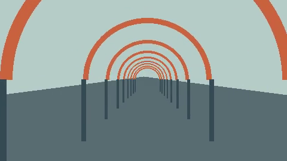
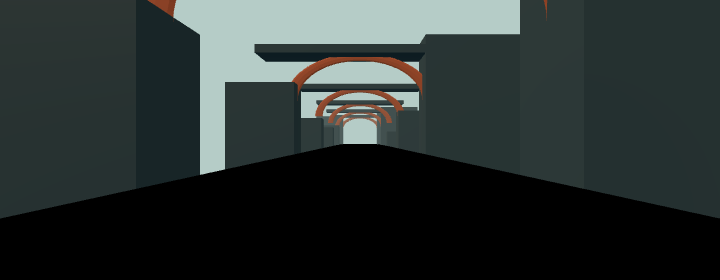
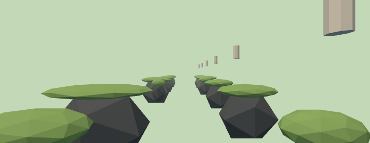

# Release evaluation

[Machine-readable local measurements](report.json) · [Original frame at 1 s](../examples/keyframe.png) · [Decoded timestamps and source digest](reference-manifest.json)

| Reference | Generated Architectural Flight |
|---|---|
|  |  |

The clip's repeated arch, cool sky and warm accent carry through. The engine adds side volumes and bridge decks, uses shaded materials, and crops to a wider viewport. The resulting histogram intersection is low. This measurement captures palette overlap only. The traversable centre line and motion tests are evaluated separately.

| Floating Archipelago | Motion Playground |
|---|---|
|  |  |

The local report identifies browser, renderer, sample count and viewport. Each world is driven through at least two chunk boundaries. The runner asserts that its Space input changes altitude, FOV or forward displacement as appropriate. The measured runs are short and use software WebGL. Frame rate depends on display cadence, viewport, renderer and load. Heap estimates are coarse browser readings. CI repeats these tests on Linux and uploads its own screenshots, recordings and JSON.

The release also includes a second browser run against the public Pages URL and a ready-to-serve static site. Unzip the site, start an HTTP server in its root (for example `python -m http.server 8000`) and open localhost:8000. Release recordings use WebM.
